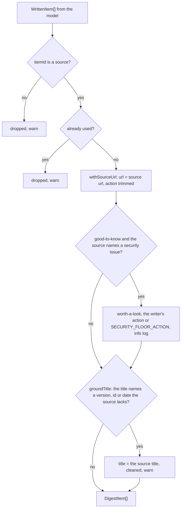

# Provenance

> What the code forces on a draft whatever the model wrote: the source url, no repeated or invented
> items, the security floor, and a title that names no fact its source lacks. Entries:
> `enforceProvenance(drafted, sources, logger)`, `raiseSecurityItems(items, sources, logger)`,
> `groundTitles(items, sources, logger)`.

## Flow

- `namesSecurityIssue` reads the source title and summary for a CVE, a `GHSA-` id, a security
  advisory, fix, patch, update or release, or a vulnerability.
- `groundTitle` reads `factTokens.ts` (`missingFacts`): versions, CVE and GHSA ids, ISO dates. The
  title ships as link text, and groundedness does not read it (`canonicalClaimText`). A summary or
  action is not repaired, no safe repair exists; groundedness checks them and `factCarry` measures
  them.

## Rules

- The url always comes from the collected item. A model url, even a plausible one, is replaced.
- The floor only raises. An act-now or worth-a-look item, or one with no urgency, comes back as is.
- The floor reads the source, never the written text: a CVE the model adds raises nothing. It errs
  toward worth-a-look: "vulnerability" in a scanner feature raises too.
- A raised item always has an action, so the floor cannot fail the format check's "needs an action".
- A wrong title fact is repaired, never rejected: a draft is not lost for one title. The repair
  is the source title, the only text that is surely right. It is used as collected (no recorded
  week has a bare tag for a title: the GitHub adapters build `<repo> <tag>`), but cleaned so the
  repair cannot fail a check: one printable line, no token the link check would read as a link
  or a character reference (`safeSourceText` in `tidy/`, the cleaner the fallback digest uses),
  cut to 120 characters. `tidyTitle` runs after it.
- One rule says what a wrong fact is, and it lives in `missingFacts`: a text may name a shorter
  version than the source ("Kubernetes 1.31" for "v1.31.2" is not wrong), so a plain version
  counts as present when it is a shorter form of a plain source version. A pre-release must match
  exactly: "1.17.0" and "1.17" for a source "1.17.0-beta1" are missing. The title repair and the
  eval metric `factCarry` both call `missingFacts`, so the pipeline and the measure agree.
- A source with no usable title cannot repair anything: the item stays and the warn says so.
- The facts of a title and of its source are compared by set lookup, and the log keeps the first 5
  facts and a count: titles and source titles are feed and model text of any length.

## Files

| File                   | Role                                                                      |
| ---------------------- | ------------------------------------------------------------------------- |
| `enforceProvenance.ts` | `enforceProvenance`, `withSourceUrl` (an empty action is left out)        |
| `securityFloor.ts`     | `raiseSecurityItems`, `namesSecurityIssue`, `SECURITY_FLOOR_ACTION`       |
| `loggedId.ts`          | `loggedId`: an item id cut to 80 characters for logs (model output)       |
| `factTokens.ts`        | `factTokensOf`, `missingFacts`: the versions, CVE ids and dates of a text |
| `titleFacts.ts`        | `groundTitles`, `groundTitle`: the title repair                           |

One test file per code file.

## Gotchas

- Changing the floor words is a security change: add a case for the new word and one that must
  stay untouched. `write.urgency.test.ts` runs the same rules through `writeStep`.
- `factTokens.ts` changes nothing itself: `groundTitle` and the eval metric `factCarry`
  (`evals/metrics/digest/factCarry.ts`) read it, so a new fact shape, or a change to the
  shorter-version rule, changes which titles are repaired and what the metric scores. It reads
  model output, so every pattern must stay linear; `factTokens.test.ts` times strings of 100,000
  characters, `missingFacts` with its shorter-form lookup too.
- Do not add a second fact rule beside `missingFacts` (a stricter one in the metric, a looser one
  in the repair): that is how the two once came apart.
