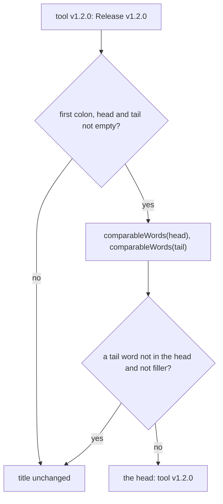

# Tidy

> Fixes the two text faults writers copy from feeds, em dashes and a title that says its release
> tag twice, and cleans source text before the digest prints it. Entries: `withoutEmDashes(text)`
> (`emDashes.ts`), `tidyTitle(item)` (`title.ts`), `safeSourceText(text)` (`sourceText.ts`).

## Flow

- `comparableWords` lowercases and splits at spaces and `, ; : ( ) [ ]`, drops closing dots and a
  `v` before a digit, so `v1.2.0.` and `1.2.0` are the same word.
- `withoutEmDashes` turns a run of em dashes, with the spaces and commas around it, into one
  comma; at the start or end of the text the run is dropped.
- `safeSourceText` splits at whitespace and drops each token that holds `://`, `//`, `www.`, `](`,
  `&#`, a scheme such as `http:` or `mailto:`, or a character reference (`&amp;`).

## Rules

- A title that says something new after the colon is never changed, and only the first colon counts.
- Filler words (`release`, `released`, `version`, `tag`, `v`) add nothing next to a version.
- `withoutTrailingDots` is a loop, not `/\.+$/`: that pattern is quadratic on a long run of dots,
  and the title is model output. `title.test.ts` checks the run time.
- All return new values and change nothing they were given.
- `safeSourceText` is the one cleaner of source text; the checks keep their own link detectors.
  The fallback digest (`../fallbackDigest.ts`, after its own em dash, `href=`, pipe and backslash
  steps) and the title repair (`../provenance/titleFacts.ts`, after `printableLine`) both call it.

## Files

| File                 | Role                                                                            |
| -------------------- | ------------------------------------------------------------------------------- |
| `emDashes.ts`        | `withoutEmDashes`                                                               |
| `title.ts`           | `tidyTitle`, `collapseRestatedTag`, `comparableWords`, `withoutTrailingDots`    |
| `sourceText.ts`      | `safeSourceText`, `SOURCE_TITLE_MAX_CHARS` (120, the cut of a source title)     |
| `emDashes.test.ts`   | Runs, ends of the text, text that must stay as it is                            |
| `title.test.ts`      | Collapsing and not collapsing, the words compared, dots, speed on hostile input |
| `sourceText.test.ts` | Each link-like token, clean text left alone, speed on hostile input             |

## Gotchas

- The format check rejects em dashes and the write prompt asks for none; this is the backstop.
- A wider collapse rule can hide a real difference between two releases. Add a "leaves it alone"
  case with every new rule; `write.test.ts` runs the same cases through `writeStep`.
- `tidy/` imports neither `provenance/` nor `fallbackDigest.ts`. `safeSourceText` cleans, it does
  not validate: the link and format checks still run on the rendered digest.
