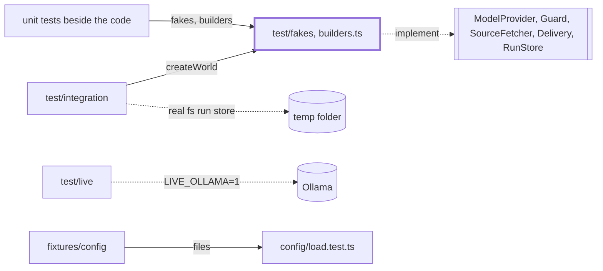
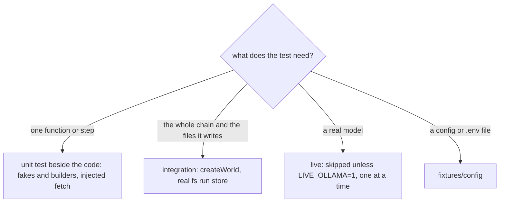

# Test kit

> What several features' tests share: fakes for the five ports, builders for the common data, the
> cross-feature integration tests, the live Ollama checks and the config fixtures. Unit tests do
> not live here: they sit next to the code. Entry: `import { ... } from 'test/fakes'` (`fakes/index.ts`)
> and `test/builders.ts`.

## Context

## Flow

## Rules

- A fake follows its port. A port change changes the fake in the same commit: `fakes.test.ts` pins
  the fakes, and `fsRunStore.test.ts` runs the same cases on `MemoryRunStore` and the real store.
- The kit stays small. A helper that one feature uses lives in that feature's test or its
  `__fixtures__/`, not here.
- `makeConfig` puts `dataDir` under a temp folder (`TEST_DATA_DIR`), so no test writes to `dist/`.
- Live tests are lane `gpu`: `OLLAMA_MAX_LOADED_MODELS=1` means one at a time on this machine.

## Files

| Path               | Role                                                                                                                                                                                                                                        |
| ------------------ | ------------------------------------------------------------------------------------------------------------------------------------------------------------------------------------------------------------------------------------------- |
| `fakes/`           | `FakeModelProvider` (scripted, records calls), `yesNoAnswers`, `FakeInputGuard`, `FakeOutputGuard`, `FakeSourceFetcher`, `CapturingDelivery`, `MemoryRunStore`; `index.ts` is the one import, with `fixedClock`, `noopLogger`, `noopTracer` |
| `builders.ts`      | `makeItem`, `makeScoredItem`, `makeDigest`, `makeDraft`, `makeConfig`, `makeRunRecord`                                                                                                                                                      |
| `integration/`     | See below; `integration/CLAUDE.md`                                                                                                                                                                                                          |
| `live/`            | `ollama`, `smoke` (one real dry run on `light`) and `think` checks against a local Ollama                                                                                                                                                   |
| `fixtures/config/` | Valid and broken config and `.env` files for `config/load.test.ts`; `project/` for the cwd lookup                                                                                                                                           |
| `package.test.ts`  | Pins `package.json` (the `prepack` build)                                                                                                                                                                                                   |

`test/integration/` holds the cross-feature tests and their kit in `harness/` (`createWorld` builds
the real chain on `test/fakes` plus the real fs run store; see `test/integration/CLAUDE.md`).
`fakes/`, `integration/` and `live/` are described here and get no `CLAUDE.md` of their own,
except `integration/`, which has one.

## Gotchas

- `fakes/`, `builders.ts` and the fakes' contract are frozen files on issue branches
  (`.claude/rules/parallel-work.md`): a change goes through the coordinator.
- `config/load.test.ts` pins the error texts of the broken files in `fixtures/config/`: adding or
  editing one there can change a test in `src/config/`.
- `think.live.test.ts` imports `GRANITE_CRITERIA` and `parseGraniteScore` from `guards/adapters`.
