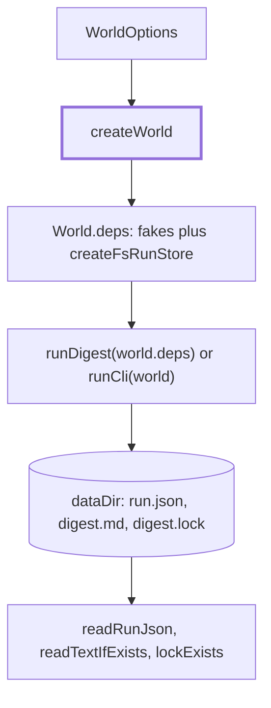

# Integration tests

> Cross-feature tests: the real chain, steps, checks and run store on fakes, asserting on what
> lands on disk. Kit entry: `createWorld(options) → World` (`harness/world.ts`).

## Flow

Add a scenario: `useDataDir()` at the top of the file, `createWorld({ now: FRIDAY, dataDir: dataDir() })`,
run it, assert on the result, `world.deliveries`, `world.fake` calls and the files. `createOllamaWorld`
swaps in the real Ollama adapter on a scripted `fetch`.

## Rules

- The run store is real (a temp dir per test); models, feeds, guards, deliveries and the clock are fakes.
- Feed items have fixed URLs, so item ids match across worlds and processes, and are dated from `now`.
- Decisions stay on the fake model, even in an Ollama world, unless `decideOnFake: false`.
- Import from the file that defines a name; `harness.ts` keeps compat lines only.

## Files

| File                                           | Role                                                                         |
| ---------------------------------------------- | ---------------------------------------------------------------------------- |
| `harness/world.ts`, `ollamaWorld.ts`           | `createWorld`, `withModel`, `World`; `createOllamaWorld`                     |
| `harness/constants.ts`, `feedItems.ts`         | `FRIDAY`, `WEEK`, `PROFILE`, writers, areas; the five fixed feed items       |
| `harness/answers.ts`, `validDigest.ts`         | Default decision answers, `IRRELEVANT_ANSWER`; the valid digest JSON reply   |
| `harness/dataDir.ts`, `runFiles.ts`, `lock.ts` | `useDataDir`; `runFile`, `readRunJson`; `lockExists`, `writeLock`, `deadPid` |
| `harness/recordingLogger.ts`, `runCli.ts`      | `World.logs` lines; `runCli` (exit code, stdout, stderr)                     |
| `fakeOllama.ts`                                | A scripted Ollama `fetch`: hang, refuse, or answer per call; opens no socket |
| `harness.ts`                                   | Compat lines for `src/scheduler/scheduler.runDigest.test.ts`                 |

Seven `*.test.ts` files sit beside the kit; `dryRun.test.ts` has its own wiring and a `MemoryRunStore`.

## Gotchas

- `src/scheduler/scheduler.runDigest.test.ts` imports `harness.ts`: move it to `harness/` files, then delete it.
- `defaultAnswers` is keyed by `QUESTION_IDS` and `JUDGE_CRITERIA`: renaming one changes every world.
- `TEST_TIMEOUT_MS` (15 s) covers real retry backoffs. Under load these tests flake: rerun alone.
